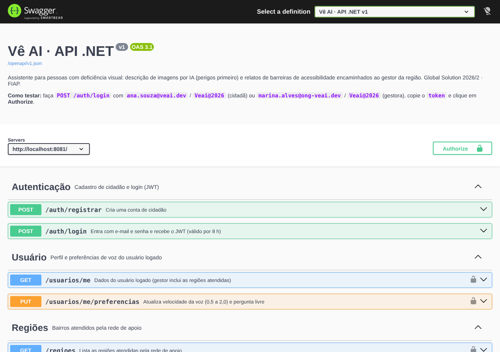
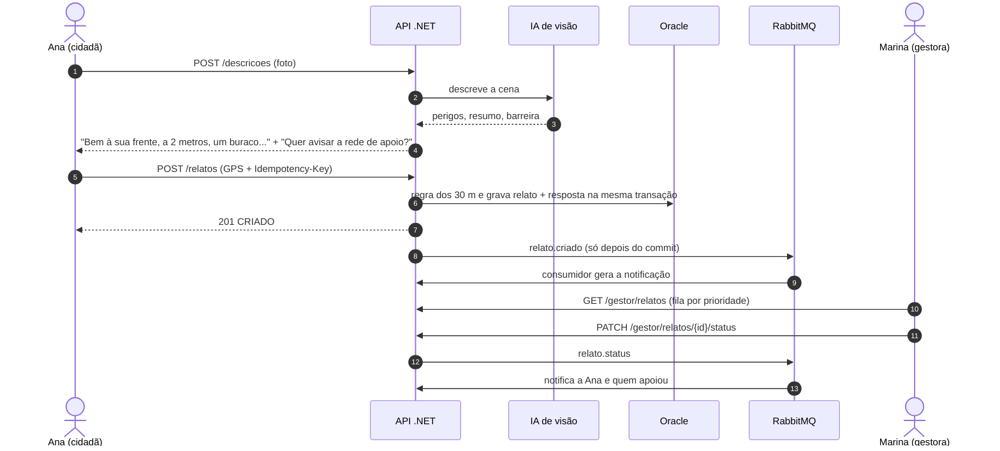
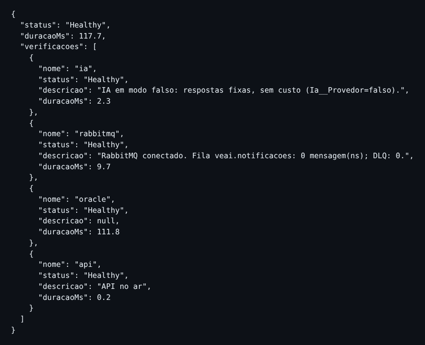
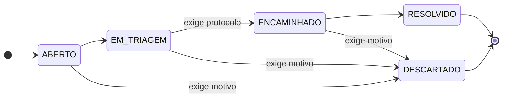
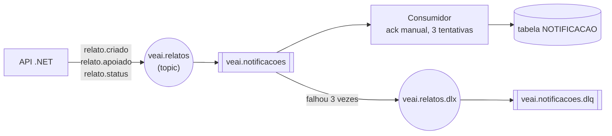
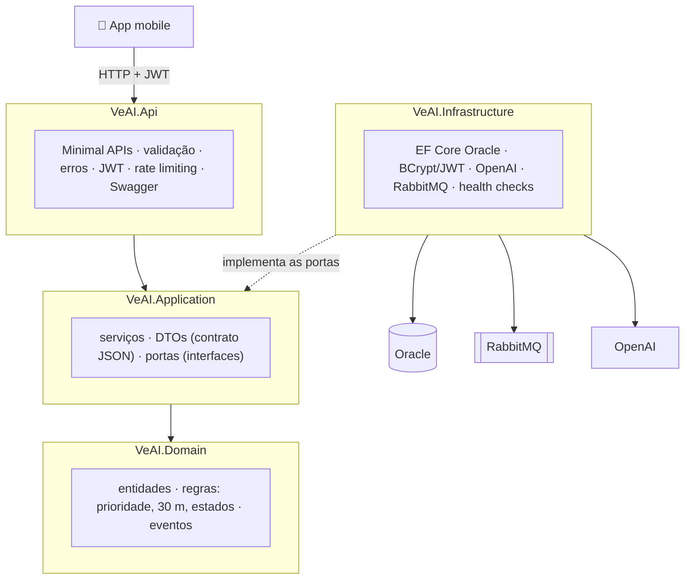

# Vê AI · API .NET


**Global Solution 2026/2 · FIAP 2TDSPX · Advanced Business Development with .NET · tema CitizenTech**

> **O Vê AI é um assistente para pessoas com deficiência visual.** O celular fotografa o caminho e a IA narra por áudio o que está à frente, **com os perigos primeiro**. Quando aparece uma barreira de acessibilidade (buraco, calçada obstruída, rampa irregular, piso tátil faltando, semáforo sem som), a pessoa avisa a rede de apoio com um toque. O **relato** chega com GPS ao **gestor da região** (ONG/CRAS), que o encaminha ao órgão público, e quem relatou é avisado a cada passo.

Esta é a API que o app mobile consome. Ela tem **o mesmo contrato** da [API Java](https://github.com/lgaxd/ve-ai-api-java) e usa **o mesmo banco Oracle** do repositório [database](https://github.com/lgaxd/ve-ai-database): o app funciona com qualquer uma das duas.

| Integrante | RM |
|---|---:|
| Lucas Grillo Alcântara | 561413 |
| Pietro Ferreira Gomes Abrahamian | 561469 |
| Pedro Peres Benitez | 561792 |
| Lucca Ramos Mussumecci | 562027 |

---

## Sumário

1. [Rodar em 3 comandos](#1-rodar-em-3-comandos)
2. [Como o Vê AI funciona](#2-como-o-vê-ai-funciona)
3. [Roteiro de avaliação, critério por critério](#3-roteiro-de-avaliação-critério-por-critério)
4. [Testes automatizados](#4-testes-automatizados)
5. [Endpoints e regras de negócio](#5-endpoints-e-regras-de-negócio)
6. [Arquitetura](#6-arquitetura)
7. [Configuração, outras formas de rodar e problemas comuns](#7-configuração-outras-formas-de-rodar-e-problemas-comuns)

---

## 1. Rodar em 3 comandos

**Só precisa do [Docker Desktop](https://www.docker.com/products/docker-desktop/) aberto.** API, banco Oracle e RabbitMQ sobem juntos, e o banco já vem com dados de demonstração.

```bash
git clone https://github.com/Luccarm07/ve-ai-api-dotnet.git
cd ve-ai-api-dotnet
docker compose up -d --build
```

Na primeira vez leva de **3 a 5 minutos** (o Oracle carrega o schema). Confira com `docker compose ps`: `oracle` e `rabbitmq` devem aparecer como **healthy** e a `api` como **Up**.

| Abra | Para quê |
|---|---|
| **http://localhost:8081/swagger** | testar todas as rotas pelo navegador |
| http://localhost:8081/health | ver a saúde da API, do banco, do RabbitMQ e da IA |
| http://localhost:15672 (`veai` / `veai`) | painel do RabbitMQ: filas e mensagens |

**Usuários de teste** (senha de todos: **`Veai@2026`**):

| E-mail | Perfil | Para testar |
|---|---|---|
| `ana.souza@veai.dev` | 👩‍🦯 CIDADAO | criar relatos e descrições |
| `bruno.lima@veai.dev` | 👨‍🦯 CIDADAO | apoiar o relato da Ana (regra dos 30 m) |
| `marina.alves@ong-veai.dev` | 🧑‍💼 GESTOR de Pinheiros e Sé | fila, mudança de status, histórico |
| `rafael.costa@cras-veai.dev` | 🧑‍💼 GESTOR de Vila Mariana | ver o bloqueio de outra região (403) |

> **Como entrar no Swagger:** `POST /auth/login` → copie o `token` da resposta → botão **Authorize** (cadeado) → cole → **Authorize**. Para trocar de usuário: **Authorize → Logout** e repita com outro e-mail.



Para parar: `docker compose down` (os dados ficam salvos; `docker compose down -v` apaga tudo e recarrega o seed na próxima subida).

---

## 2. Como o Vê AI funciona



---

## 3. Roteiro de avaliação, critério por critério

| # | Critério da GS | Pts | Em uma frase |
|---|---|:-:|---|
| 01 | [Minimal API, validações, HTTP e Swagger](#critério-01) | 20 | 18 rotas em Minimal APIs, erros padronizados em português, Swagger completo |
| 02 | [JWT: autenticação e autorização](#critério-02) | 20 | perfis CIDADAO e GESTOR; o gestor só enxerga as regiões que atende |
| 03 | [Idempotência](#critério-03) | 15 | `Idempotency-Key`: o mesmo envio nunca cria dois relatos, nem em paralelo |
| 04 | [Rate limiting com 429](#critério-04) | 15 | middleware nativo do ASP.NET Core, com `Retry-After` |
| 05 | [Testes xUnit](#critério-05) | 20 | 133 testes: 80 unitários e 53 de integração |
| 06 | [Health checks](#critério-06) | 10 | API, Oracle, RabbitMQ e IA, com Healthy / Degraded / Unhealthy |

> 💡 **Atalho para o roteiro inteiro:** abra [`docs/roteiro-avaliacao.http`](docs/roteiro-avaliacao.http) no **Visual Studio** (ou VS Code com a extensão REST Client) e clique em **Enviar solicitação** em cada bloco, na ordem. Os tokens e o id do relato passam de um passo para o outro sozinhos, e o resultado esperado está escrito em cada bloco. Os passos abaixo são os mesmos, feitos pelo Swagger.

<a id="critério-01"></a>
<details>
<summary><b>01 · Minimal API RESTful, validações, códigos HTTP e Swagger</b> (20 pts)</summary>

**Para que serve no Vê AI:** o app lê as respostas em voz alta. Por isso todo erro tem o mesmo formato e uma frase curta em português, que o app pode falar direto.

```json
{ "timestamp": "...", "status": 400, "erro": "Bad Request", "mensagem": "Confira os dados enviados.",
  "campos": [ { "campo": "texto", "mensagem": "Descreva o problema." } ] }
```

**Como foi feito:** 18 rotas em Minimal APIs (`MapGroup`, sem controllers), validação dos corpos com DataAnnotations num filtro de endpoint, um tratador único de exceções e o OpenAPI nativo do ASP.NET Core com Swagger UI. Cada rota documenta suas respostas, exemplos e o cadeado de autenticação.

**Como testar** (logado como Ana):

| Ação no Swagger | Esperado |
|---|---|
| `POST /relatos` com `{"texto": "", "latitude": 100}` | **400** "Confira os dados enviados." com os campos tipo, gravidade, texto, latitude e longitude |
| `GET /relatos/{id}` com id `999999` | **404** "Relato não encontrado." |
| `DELETE /relatos/{id}` de um relato com apoio ([critério 03](#critério-03)) | **409** "Outras pessoas já confirmaram este relato. Ele não pode ser excluído." |
| `PATCH /gestor/relatos/{id}/status` pulando etapa ([critério 02](#critério-02)) | **422** "Não é possível mudar o relato de EM_TRIAGEM para RESOLVIDO." |
| `POST /descricoes` com um arquivo que não é foto | **415** "Formato de foto não suportado. Use JPEG, PNG ou WebP." |

**No código:** [Endpoints/](src/VeAI.Api/Endpoints) · [Erros/](src/VeAI.Api/Erros) · [OpenApiConfig.cs](src/VeAI.Api/Configuracao/OpenApiConfig.cs)
</details>

<a id="critério-02"></a>
<details>
<summary><b>02 · Autenticação e autorização com JWT</b> (20 pts)</summary>

**Para que serve no Vê AI:** o cidadão só vê os próprios relatos e descrições; o gestor de uma ONG só vê e altera os relatos **dos bairros que atende**.

**Como foi feito:** JWT HS256 (claims `sub` = id e `papel` = CIDADAO ou GESTOR), senhas com BCrypt (compatível com o seed do Oracle), políticas por perfil e uma política padrão que exige login em toda rota, exceto login, cadastro, health e Swagger. A chave vem só do `.env`.

**Como testar:**

| Passo | Esperado |
|---|---|
| Sem login, `GET /usuarios/me` | **401** "Faça login para continuar." |
| Login com senha errada | **401** "E-mail ou senha incorretos." (a mesma mensagem para e-mail inexistente) |
| Login da Ana → **Authorize** → `GET /usuarios/me` | **200** com `"papel": "CIDADAO"` |
| Ainda como Ana, `GET /gestor/relatos` | **403** "Você não tem permissão para esta ação." |
| Como **Marina**, `PATCH /gestor/relatos/{id}/status` com `{"status":"EM_TRIAGEM","comentario":"Vistoria marcada"}` → depois `{"status":"RESOLVIDO"}` → depois `{"status":"ENCAMINHADO","protocoloOrgao":"SP156-2026-0012345"}` | **200**, depois **422** (não pula etapa), depois **200** |
| Como **Marina**, `GET /gestor/relatos/{id}/historico` | as mudanças, com `"gestorNome": "Marina Alves"` |
| Como **Rafael**, `GET /gestor/relatos/{id}` do relato de Pinheiros | **403** "Este relato é de uma região que você não atende." |

**No código:** [AutenticacaoJwt.cs](src/VeAI.Api/Seguranca/AutenticacaoJwt.cs) · [Seguranca.cs](src/VeAI.Infrastructure/Seguranca/Seguranca.cs) · [GestorRelatoServico.cs](src/VeAI.Application/Servicos/GestorRelatoServico.cs)
</details>

<a id="critério-03"></a>
<details>
<summary><b>03 · Idempotência</b> (15 pts)</summary>

**Para que serve no Vê AI:** quem não enxerga pode tocar duas vezes no botão, e na rua a internet cai e o app reenvia. Sem idempotência, cada reenvio criaria outro relato duplicado na fila do gestor.

**Como foi feito:** duas camadas.
1. **Header `Idempotency-Key`** em `POST /relatos`: a resposta fica gravada (tabela `IDEMPOTENCIA`) **na mesma transação** que cria o relato. A mesma chave com o mesmo corpo devolve a resposta gravada, com o header `Idempotent-Replayed: true`; com outro corpo, **422**. Vale por 24 h, por usuário. Testado no Oracle com **4 envios simultâneos com a mesma chave: 1 relato só**.
2. **Regra dos 30 m:** um relato do mesmo tipo a até 30 m de outro em aberto vira **apoio** (+1), e repetir dá `JA_REGISTRADO`. Assim nem pessoas diferentes duplicam a mesma barreira.

**Como testar** (num banco novo, o primeiro relato criado costuma ter o id **16**):

| Passo | Esperado |
|---|---|
| Como **Ana**, `POST /relatos` com **Idempotency-Key** = `teste-1` e o corpo abaixo | **201** `"resultado": "CRIADO"`, região **Pinheiros** (escolhida pelo GPS). Anote o `id` |
| **Execute** de novo, igual | **201** com o **mesmo id** e o header `idempotent-replayed: true` |
| Mesma chave `teste-1`, trocando o `texto` | **422** "Esta Idempotency-Key já foi usada com outro conteúdo." |
| Como **Bruno**, o mesmo corpo, **sem** chave | **200** `"APOIO_REGISTRADO"`, mesmo id, `"totalApoios": 1`, prioridade de **5 para 10** |
| Bruno de novo | **200** `"JA_REGISTRADO"` (o apoio não conta duas vezes) |
| Como **Ana**, `DELETE /relatos/{id}` | **409**: o relato já foi confirmado por outra pessoa |

```json
{"tipo":"CALCADA_DANIFICADA","gravidade":"ALTA","texto":"Buraco grande na calçada","latitude":-23.5650,"longitude":-46.6905,"endereco":"Rua dos Pinheiros, 500"}
```

**No código:** [IdempotenciaServico.cs](src/VeAI.Application/Servicos/IdempotenciaServico.cs) · [RelatoServico.cs](src/VeAI.Application/Servicos/RelatoServico.cs) · [Relato.cs](src/VeAI.Domain/Entities/Relato.cs)
</details>

<a id="critério-04"></a>
<details>
<summary><b>04 · Rate limiting com HTTP 429</b> (15 pts)</summary>

**Para que serve no Vê AI:** no modo automático o celular manda uma foto a cada poucos segundos, e cada foto é uma chamada paga à IA. O limite protege o custo e a API. No login, ele protege as contas contra força bruta.

**Como foi feito:** middleware nativo `Microsoft.AspNetCore.RateLimiting`, com três políticas:

| Política | Limite | Algoritmo | Onde |
|---|---|---|---|
| `fotos` | 20 por minuto, por usuário | janela fixa | `POST /descricoes` e `POST /descricoes/{id}/pergunta` |
| `login` | 10 por minuto, por IP | janela deslizante | `/auth/login` e `/auth/registrar` |
| global | 300 por minuto, por usuário ou IP | token bucket | todas as rotas |

Acima do limite: **429**, header **`Retry-After`** e a mensagem "Muitas fotos em pouco tempo. Aguarde N segundos e tente de novo." Os limites mudam pelo `.env`.

**Como testar:**
- **Login (1 minuto):** `POST /auth/login` com `{"email":"ana.souza@veai.dev","senha":"errada"}` e **Execute 11 vezes**. Da 1ª à 10ª: **401**. A 11ª: **429** com `retry-after`. Espere 1 minuto antes de entrar de novo.
- **Fotos (opcional):** crie um arquivo `.env` na pasta com `RateLimit__FotosPorMinuto=3`, rode `docker compose up -d`, entre de novo e envie 4 fotos em `POST /descricoes`. A 4ª: **429** "Muitas fotos em pouco tempo...". Depois apague o `.env` e rode `docker compose up -d`.

**No código:** [LimitesRequisicao.cs](src/VeAI.Api/Configuracao/LimitesRequisicao.cs)
</details>

<a id="critério-05"></a>
<details>
<summary><b>05 · Testes unitários e de integração com xUnit</b> (20 pts)</summary>

**Para que serve no Vê AI:** as regras (prioridade, 30 m, estados, idempotência) são o que garante que a pessoa certa é avisada e que nada se duplica. Os testes provam isso a cada mudança.

**Como foi feito:** **133 testes**. 131 rodam em qualquer máquina, sem Docker; 2 rodam contra um Oracle real quando configurado. Detalhes na [seção 4](#4-testes-automatizados).

**Como testar:** com o [.NET SDK 10](https://dotnet.microsoft.com/download), rode na pasta do projeto:

```bash
dotnet test
```

Esperado: **Aprovados: 131, Ignorados: 2**. No Visual Studio: **Teste → Gerenciador de Testes → Executar Todos**.

**No código:** [tests/VeAI.Tests](tests/VeAI.Tests)
</details>

<a id="critério-06"></a>
<details>
<summary><b>06 · Health checks: API, banco e serviços externos</b> (10 pts)</summary>

**Para que serve no Vê AI:** quem opera a API sabe na hora se o problema é o banco, a fila de notificações ou a IA, sem abrir logs.

**Como foi feito:** quatro verificações, com três níveis:

| Verificação | O que confere | Se falhar |
|---|---|---|
| `api` | o processo está vivo | (é a própria API) |
| `oracle` | consulta real no banco | **Unhealthy** (HTTP 503): sem banco não há como atender |
| `rabbitmq` | conexão e mensagens na fila e na DLQ | **Degraded** (HTTP 200): os relatos seguem, só as notificações atrasam |
| `ia` | OpenAI acessível, sem gastar tokens | **Degraded**: relatos e notificações seguem |

Rotas: `/health` (tudo), `/health/live` (só o processo) e `/health/ready` (dependências).

**Como testar** (no terminal, na pasta do projeto):

| Comando | Recarregue `/health` e veja |
|---|---|
| (tudo no ar) | `"status": "Healthy"` nos 4 itens |
| `docker compose stop rabbitmq` | `"status": "Degraded"`, rabbitmq "inacessível" |
| `docker compose start rabbitmq` e `docker compose stop oracle` | `"status": "Unhealthy"` e HTTP **503** |
| `docker compose start oracle` (aguarde 30 s) | `"Healthy"` de novo |



**No código:** [Program.cs](src/VeAI.Api/Program.cs) · [IaHealthCheck.cs](src/VeAI.Infrastructure/Ia/IaHealthCheck.cs) · [Rabbit.cs](src/VeAI.Infrastructure/Mensageria/Rabbit.cs)
</details>

<details>
<summary><b>Extra · Notificações (RabbitMQ) e descrição por IA</b></summary>

**Notificações:** depois dos passos dos critérios 02 e 03, chame `GET /notificacoes` com cada usuário:

| Quem | Recebe |
|---|---|
| Marina (gestora da região) | "Novo relato de calçada danificada em Pinheiros." |
| Ana (autora) | "Mais uma pessoa confirmou seu relato de calçada danificada. Agora 1 pessoa já confirmou." e cada mudança de status, como "...foi encaminhado ao órgão responsável. Protocolo SP156-2026-0012345." |
| Bruno (apoiador) | "O relato de calçada danificada que você apoiou está em análise pela rede de apoio." |

No painel do RabbitMQ (http://localhost:15672, aba **Queues**) aparecem a fila `veai.notificacoes` e a dead-letter queue `veai.notificacoes.dlq`.

**Descrição por IA:** como Ana, `POST /descricoes` → **Escolher arquivo** com qualquer foto `.jpg` → **Execute**. Resposta **201**, com os perigos primeiro e, quando há uma barreira com confiança alta, a sugestão "Parece haver calçada obstruída. Quer avisar a rede de apoio?".

> Por padrão a IA roda em **modo de demonstração** (sem custo): cada foto cai num de 4 cenários fixos (poste, bicicleta, buraco ou foto escura), escolhidos pelos bytes do arquivo. Para a IA de verdade, coloque `Ia__Provedor=openai` e `OPENAI_API_KEY=...` no `.env`.

**Modo automático:** envie a **mesma foto** de novo, informando em `anteriorId` o `id` da resposta anterior. Resposta com `"novidade": false` e uma frase curta, como "Poste, muro e lixeira continuam no mesmo lugar, à sua frente."
</details>

---

## 4. Testes automatizados

```bash
dotnet test
```

A integração sobe a API inteira em memória (`WebApplicationFactory`), com **SQLite no lugar do Oracle** e o mesmo modelo do EF Core. Por isso não precisa de Docker nem de banco.

| Pasta | Quantos | O que cobre |
|---|:-:|---|
| `Unit/Domain` | 50 | prioridade, máquina de estados, regra dos 30 m, exclusão com apoios (409), sugestão de relato, assinatura da foto |
| `Unit/Application` | 14 | login e cadastro, idempotência (repetir, conflito, vencimento, falha), modo automático, memória de sugestões |
| `Unit/Infrastructure` | 16 | **mapeamento EF Core × DDL Oracle** (toda coluna mapeada existe no script e vice-versa), BCrypt compatível com o seed, JWT, cliente da OpenAI com HTTP simulado, mensagens da fila, 3 tentativas + DLQ |
| `Integration` | 53 | todas as rotas, perfis, 401/403/404/409/413/415/422/429, idempotência, notificações de ponta a ponta e o **contrato com a API Java** (as mesmas rotas e os mesmos campos JSON) |

Dois testes rodam contra um **Oracle de verdade** quando a variável `VEAI_ORACLE_TESTE` existe (sem ela aparecem como *Ignorados*):

```powershell
docker compose up -d oracle
$env:VEAI_ORACLE_TESTE="User Id=veai;Password=veai;Data Source=localhost:1521/XEPDB1"   # PowerShell
dotnet test
```

---

## 5. Endpoints e regras de negócio

| Grupo | Rotas | Quem usa |
|---|---|---|
| Autenticação | `POST /auth/registrar` · `POST /auth/login` | público (10/min por IP) |
| Usuário | `GET /usuarios/me` · `PUT /usuarios/me/preferencias` | logado |
| Regiões | `GET /regioes` | logado |
| Descrições | `POST /descricoes` (foto) · `GET /descricoes` · `GET` e `DELETE /descricoes/{id}` · `PATCH /descricoes/{id}/avaliacao` · `POST /descricoes/{id}/pergunta` | CIDADAO (fotos: 20/min) |
| Relatos | `POST /relatos` (Idempotency-Key) · `GET /relatos/meus` · `GET`, `PUT` e `DELETE /relatos/{id}` | CIDADAO |
| Gestor | `GET /gestor/relatos` · `GET /gestor/relatos/{id}` · `GET /gestor/relatos/{id}/historico` · `PATCH /gestor/relatos/{id}/status` | GESTOR, só nas suas regiões |
| Notificações | `GET /notificacoes` · `PATCH /notificacoes/{id}/lida` | logado |
| Saúde | `GET /health` · `/health/live` · `/health/ready` | público |

**Regras** (as mesmas do banco e da API Java):

- **Regra dos 30 m:** um relato novo do mesmo tipo, a até 30 m de outro ainda não finalizado, vira **+1 apoio**: `201 CRIADO`, `200 APOIO_REGISTRADO` ou `200 JA_REGISTRADO`. A região é a de centro mais próximo do GPS.
- **Prioridade na fila:** peso da gravidade (BAIXA 1, MEDIA 3, ALTA 5) × (1 + apoios) + dias em aberto. Vale 0 quando finalizado e é recalculada de hora em hora.
- **Máquina de estados:**



  Não pula etapa, não volta e não sai de status final (**422**).
- **Exclusão pelo autor:** só enquanto ABERTO (**422**) e sem apoios de outras pessoas (**409**).
- **Descrição por IA:** perigos primeiro, com direção e distância. A **foto nunca é gravada**, só o texto. Sugestão de relato quando a confiança da barreira é ≥ 0,7, sem repetir a mesma por 2 minutos no modo automático.

**Notificações via RabbitMQ** (a mesma topologia da API Java):



---

## 6. Arquitetura

**Clean Architecture** em 4 projetos + testes. As dependências apontam para dentro: o **domínio** não conhece HTTP, banco nem RabbitMQ, e por isso as regras são testadas isoladas.



```
src/
  VeAI.Domain/          entidades, enums, regras puras, eventos e exceções de negócio
  VeAI.Application/     DTOs (contrato JSON), portas (repositórios, IA, mensageria) e serviços
  VeAI.Infrastructure/  EF Core (Oracle), JWT/BCrypt, OpenAI e descritor falso, RabbitMQ, health checks
  VeAI.Api/             Program.cs, Minimal APIs, validação, erros, JWT, rate limiting, OpenAPI/Swagger
tests/VeAI.Tests/       Unit/ e Integration/
database/oracle/        scripts do banco (os mesmos da API Java e do repositório database)
docs/                   roteiro .http, imagens e contrato OpenAPI da API Java
```

**Decisões que valem destacar:**

- **EF Core sobre o banco que já existe:** a API não cria tabelas; ela mapeia as do repositório database. Um teste confere esse mapeamento contra o script do banco a cada `dotnet test`.
- **Gatilhos do Oracle respeitados:** o `trg_conta_apoio` soma o apoio no próprio banco; a API grava na ordem certa para o apoio nunca contar duas vezes.
- **Concorrência:** a busca da regra dos 30 m e a mudança de status usam `SELECT ... FOR UPDATE`. Testado no Oracle com 3 apoios simultâneos: o total ficou em 3.
- **Eventos só depois do commit:** nada é avisado se a operação for desfeita, e com o RabbitMQ fora a operação do usuário continua funcionando.
- **Mensagens feitas para voz:** erros e notificações são frases curtas em português, porque o app as lê em voz alta.
- **Privacidade e segurança:** a foto não é gravada; senhas com BCrypt; nenhum segredo no código (banco, JWT e OpenAI vêm do `.env`, que não vai para o git). As senhas `veai/veai` do `docker-compose.yml` são só dos containers locais.

---

## 7. Configuração, outras formas de rodar e problemas comuns

<details>
<summary><b>Rodar pelo Visual Studio ou com <code>dotnet run</code></b></summary>

```bash
docker compose up -d oracle rabbitmq      # só o banco e a fila
dotnet run --project src/VeAI.Api         # Swagger em http://localhost:5046/swagger
```

No Visual Studio: abra `VeAI.sln`, escolha o perfil **http** (ao lado do ▶) e aperte **F5**. Sem `.env`, em desenvolvimento a API usa o Oracle do Docker (`appsettings.Development.json`) e a fila em memória. No roteiro `.http`, troque a porta para `5046`.
</details>

<details>
<summary><b>Usar o Oracle da FIAP</b></summary>

Copie `.env.example` para `.env` e use a linha `ConnectionStrings__Oracle` da opção 2, com o seu RM e senha. O schema precisa ter os scripts de [database/oracle](database/oracle) (ou o `00_instalar.sql` do repositório database). Se a API Java já rodou nesse schema, nada precisa ser feito.
</details>

<details>
<summary><b>Variáveis do <code>.env</code></b></summary>

Todas estão em [.env.example](.env.example). Copie para `.env` (que não vai para o git) e ajuste só o que precisar:

| Variável | Para quê | Sem ela |
|---|---|---|
| `ConnectionStrings__Oracle` | banco | em desenvolvimento, o Oracle do Docker |
| `Jwt__Segredo` | chave do JWT (32+ caracteres) | uma chave temporária a cada inicialização |
| `Rabbit__Url` | RabbitMQ | os eventos passam por uma fila em memória |
| `Ia__Provedor`, `OPENAI_API_KEY` | IA real (`openai`) | IA em modo de demonstração, sem custo |
| `RateLimit__FotosPorMinuto` e afins | limites | 20 fotos, 10 logins e 300 requisições por minuto |
| `API_PORT`, `ORACLE_PORT`, `RABBITMQ_PORT` | portas do Docker | 8081, 1521 e 5672 |
</details>

<details>
<summary><b>Problemas comuns</b></summary>

| Sintoma | O que fazer |
|---|---|
| `docker compose up` diz que a porta está ocupada | outro projeto usa 8081, 1521 ou 5672: pare-o ou crie um `.env` com `API_PORT=8082` (e afins) |
| `/health` mostra o oracle Unhealthy logo depois de subir | o Oracle ainda está carregando: espere `docker compose ps` mostrar **healthy** |
| Swagger responde 401 em tudo | falta o token: faça login e clique em **Authorize** |
| Login responde 429 | foram mais de 10 tentativas em 1 minuto: espere 1 minuto |
| Mac com Apple Silicon lento | a imagem do Oracle XE é amd64 e roda emulada: a primeira subida demora mais |
| Quero começar com o banco zerado | `docker compose down -v` e `docker compose up -d` |
</details>
